# BANGER: ROAD TO NEON CITY

**GTA 6 is downloading. Drive to Neon City to finish the 212 GB.**

Banger is a 16-bit racer down a neon coast, seen from behind the car. The meter on screen is the 212 GB GTA 6
download, and the only way to fill it is to drive: steer through the traffic, grab the green candles, dodge the red
ones and reach Neon City before your signal runs out.

It is part of **Bitcade**, my series of browser arcade games. It plays on phones, on desktop and right inside X, with
no sign-up. I made it for Castro's Decibel community campaign. It is an unofficial fan game: GTA 6 is named only as a
fan reference, and there is no Rockstar art or logo in it.

**Version 2.5.1. Launching Thursday, November 12, 2026.**

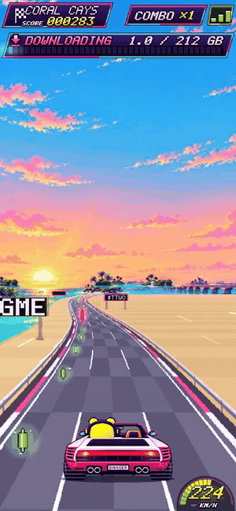

| Title | How it works | Desktop |
| --- | --- | --- |
| 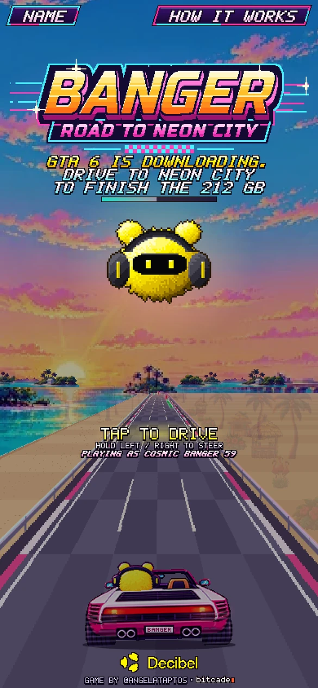 | 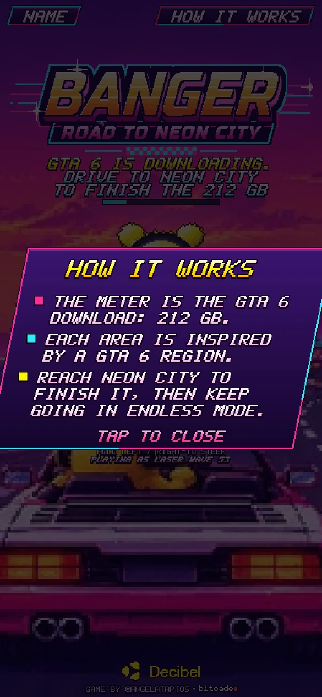 | 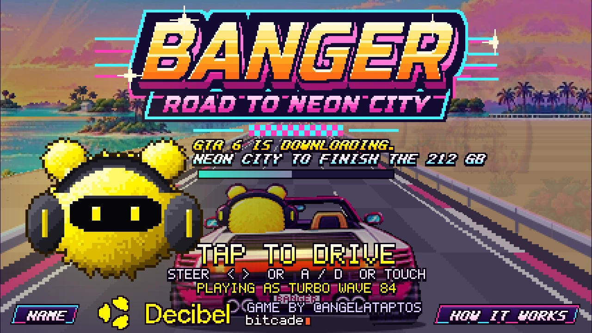 |

## The idea

A game the size of GTA 6 means a long download, so in Banger the download is the level. The meter is
212 GB, each sixth of it is a new area inspired by a GTA 6 region, and when it hits 212 GB you have reached Neon City.
Then the road keeps going in endless mode.

You drive Banger's pink convertible, BANGER on the plate, with Banger in the driver's seat in his headphones. The
faster you go, the faster the download fills.

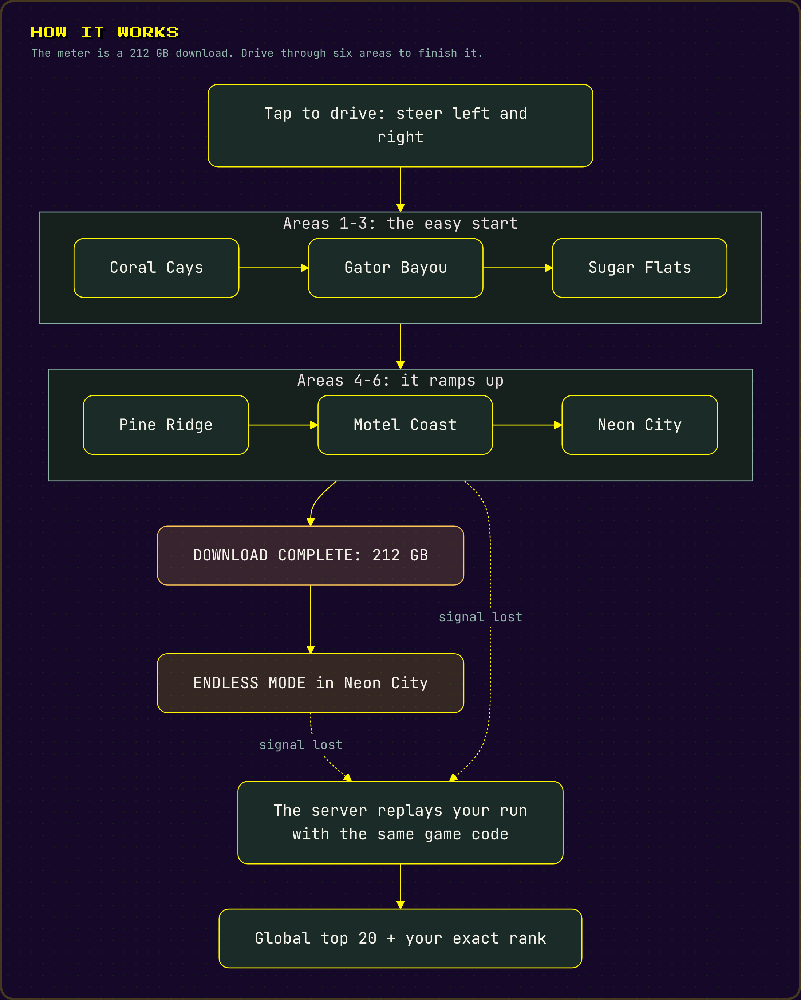

## Features

- **Six areas**, each with its own painted sky and roadside and one big moment of its own.
- **Long levels** that start easy and ramp up: Coral Cays and Gator Bayou are the welcome, Neon City is the hard part.
- **Boost shield.** A speed arrow gives you a few seconds of extra speed and a faster download. While it lasts the
  car flashes neon colours and smashes through anything in its way, and the flashing speeds up just before it ends.
- **Near-miss chains.** Skim past cars to chain close calls. Every fifth in a row is NEAR MISS X5 for +1000.
- **Sharp roadside signs** with $TTWO, $SONY and $GME that stay readable at every distance, and scenery that fades
  in smoothly instead of popping in.
- **Traffic you can feel.** Cars, vans and motorcycles are solid, keep their distance from each other and only change
  lanes into free space.
- **NOW ENTERING banners** for every new area, and Banger shouting along: WOO!, BOOM!, OOF!, KA-CHING! and more.
- **DOWNLOAD COMPLETE** with fireworks and confetti over the skyline, then **endless mode**: a harder level every
  30 seconds.
- **Global leaderboard** with exact ranks. If you land outside the top 20 you still see your own rank.
- **Play as anonymous or pick a name.** Your leaderboard name is the only thing you choose.
- **Fair scores.** Every run is replayed on the server with the same game code before it is ranked.
- **Share your run** with one tap.
- **An original soundtrack** that crossfades on the beat as you enter each new area.

## How to play

The car drives itself forward. Your job is to steer.

| Input | Action |
| --- | --- |
| Hold the left or right side of the screen | Steer |
| Left / Right arrows, or A / D | Steer |
| Tap, Space or Enter | Start |

Green candles and stock tickers fill the download faster. Hitting a red candle or running into traffic costs a signal bar; lose all three
and the connection is lost. Speed arrows give you the boost shield, and signal pickups give a bar back.

## The areas

| # | Area | Its moment |
| --- | --- | --- |
| 1 | Coral Cays | The Decibel airliner flies low overhead, livery and all |
| 2 | Gator Bayou | A lightning storm over the wetlands |
| 3 | Sugar Flats | A crop duster towing a DECIBEL banner |
| 4 | Pine Ridge | A meteor shower over the hills |
| 5 | Motel Coast | Seagulls across the sunset |
| 6 | Neon City | Searchlights and lasers from the skyline |

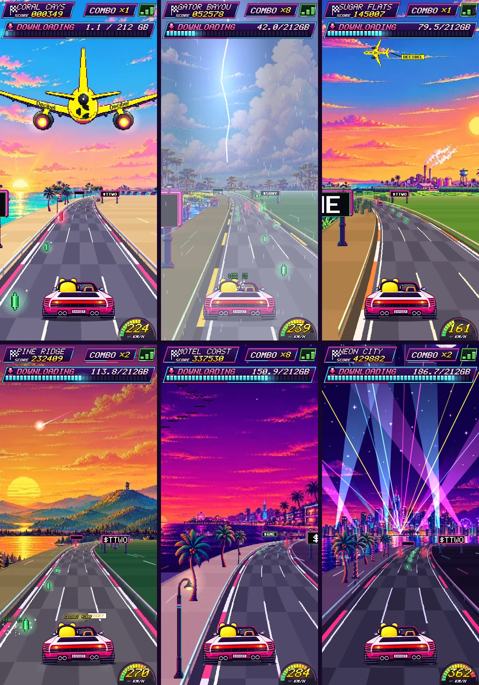

| Sugar Flats banner plane | Pine Ridge meteor shower |
| --- | --- |
| 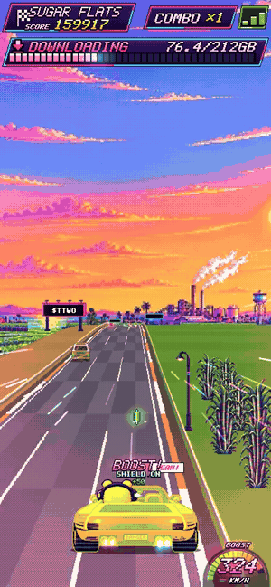 | 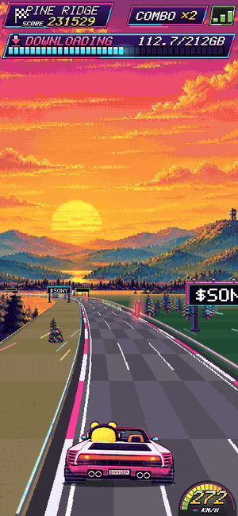 |

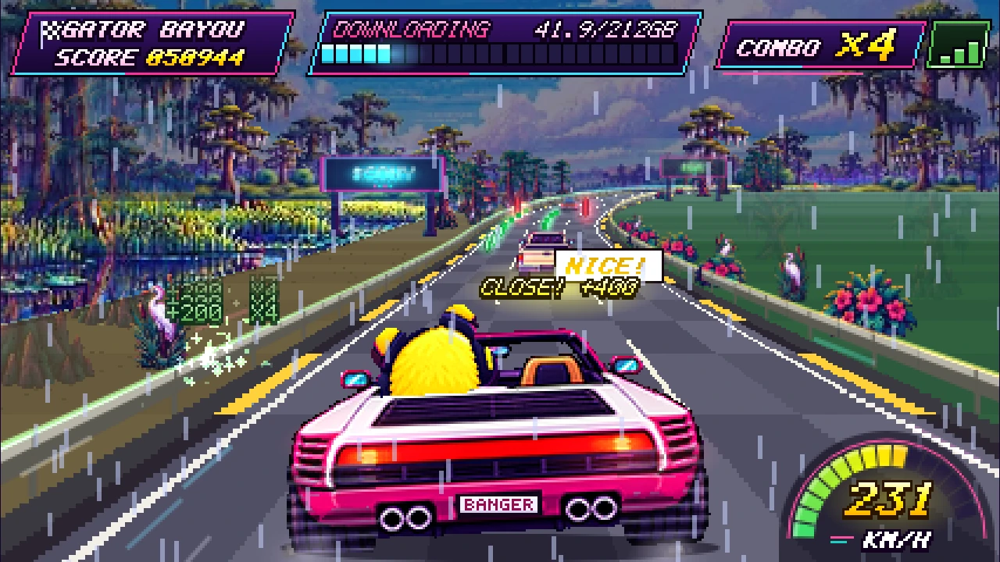

## Boost shield

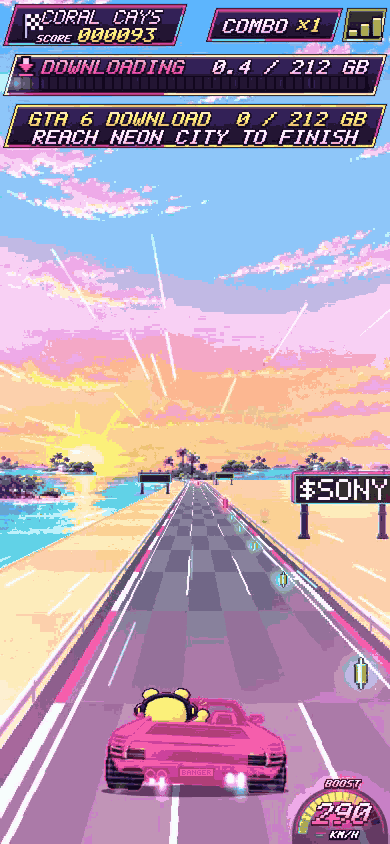

## Download complete

| The finish | Game over |
| --- | --- |
| 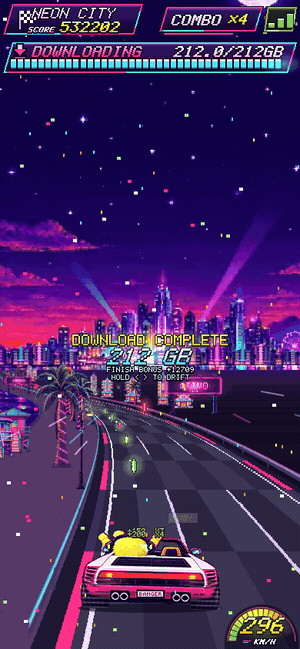 | 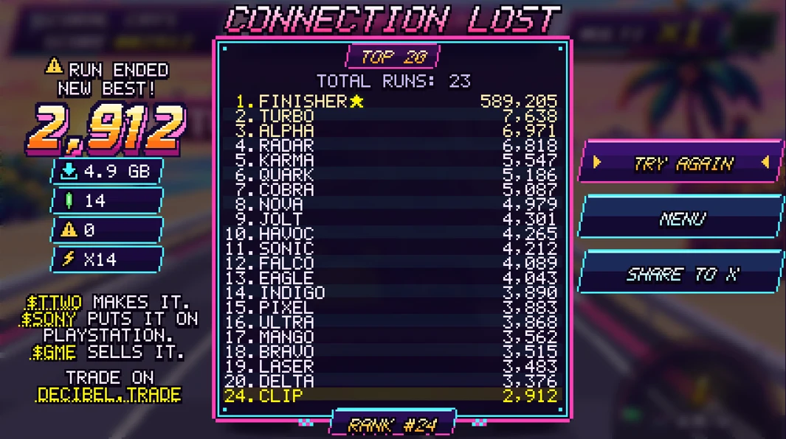 |

## Soundtrack

- [Main theme (title and Neon City)](docs/music/00_main_theme_title_and_neon_city.mp3)
- [Area 1: Coral Cays](docs/music/01_coral_cays.mp3)
- [Area 2: Gator Bayou](docs/music/02_gator_bayou.mp3)
- [Area 3: Sugar Flats](docs/music/03_sugar_flats.mp3)
- [Area 4: Pine Ridge](docs/music/04_pine_ridge.mp3)
- Area 5: Motel Coast, still in the works (the game uses a stand-in track for now)

## Credits

Game by [@angelataptos](https://x.com/angelataptos) (Angel) · Bitcade

## License

Copyright (c) 2026 Angel Fundora. All rights reserved. Source code is private.
See [LICENSE](LICENSE).
